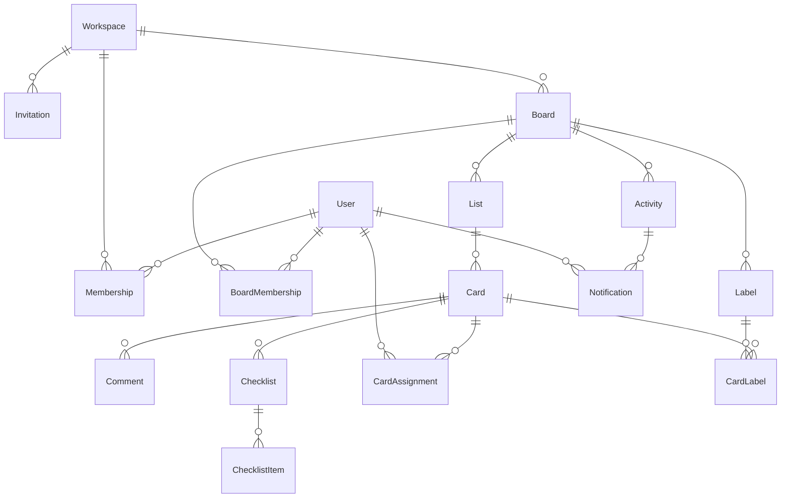

# Arquitetura

O README mostra como rodar; este documento explica por que o código está assim.
Ordem: dados, camadas, assincronia e front.

## Princípio

Um processo, zero infra externa. Rails 8.1 + SQLite: filas (Solid Queue), cache (Solid Cache),
WebSocket (Solid Cable) e busca (FTS5) vivem no próprio banco. Não há Redis, Sidekiq,
Elasticsearch nem serviço obrigatório de terceiro. `bin/setup && bin/dev` sobe o app inteiro,
e `docker compose up` sobe a mesma coisa em modo produção.

## Modelo de dados



Hierarquia: `Workspace → Board → List → Card`. O acesso é resolvido em dois níveis,
`Membership` (papel no workspace) e `BoardMembership` (papel no board), e traduzido em
policies do Pundit, nunca em `if` espalhado por controller.

Fora do diagrama: `search_index`, uma tabela virtual **FTS5** com board e card juntos (o
resultado da busca é uma lista só), mantida por `after_commit` do concern `Searchable`.
Callback de Ruby em vez de trigger de SQLite porque trigger não vai para o `schema.rb` e o
banco de teste nasceria sem índice.

### Ordenação

Posição fracionária em `decimal(16,8)`: inserir no fim é `última + 1024`, entre A e B é a
média. Mover um card é **um** `UPDATE` de uma linha; com `acts_as_list` seria um `UPDATE` em
N linhas. Quando a distância entre vizinhos cai abaixo de `0.0001`, um job reescreve as
posições daquela lista em passos de 1024 (idempotente, em transação).

## Camadas

```
request → Controller → Interactor → Model / Job
                    ↘ Policy (Pundit)
                    ↘ Presenter → props do Inertia → React
```

- **Interactors** (`app/interactors`): PORO com `call` de classe devolvendo um `Result`
  (`success?`, `value`, `errors`), sempre transacional. Sem gem: `interactor` e `dry-monads`
  resolvem o mesmo com mais cerimônia. Controller não abre transação nem conhece regra
  composta — ele chama o interactor e traduz o `Result` em resposta Inertia.
- **Policies** (`app/policies`): a mesma `BoardPolicy` autoriza o `BoardsController#show` e a
  assinatura do `BoardChannel`. Uma regra, dois pontos de entrada.
- **Presenters** (`app/presenters`): montam o payload do board. Nenhum `as_json` de model
  espalhado pelo controller.
- **Erro é tela do app**: `config.exceptions_app = routes` manda 404, 422 e 500 para uma
  página Inertia, e `RecordNotFound` é resgatado no `ApplicationController`, então dev,
  teste e produção mostram a mesma tela.

## Assincronia

Toda mutação relevante enfileira `RecordActivityJob`: o request nunca paga pela gravação da
atividade. Esse mesmo job enfileira o broadcast e as notificações, já que ele é quem sabe o
que aconteceu. Nenhum controller conhece WebSocket ou e-mail.

```
Interactor → RecordActivityJob ─┬→ Activity (feed)
                                ├→ NotifyMentionsJob → Notification + Mailer
                                └→ BroadcastBoardJob → BoardChannel
```

Filas nomeadas (`activities`, `notifications`, `maintenance`) e dois jobs recorrentes
(`DueSoonReminderJob` de hora em hora, `PurgeArchivedJob` de madrugada) em
`config/recurring.yml`, cron sem gem de cron. Em desenvolvimento e no container o supervisor
do Solid Queue sobe dentro do Puma (`SOLID_QUEUE_IN_PUMA=1`); escalando, vira um processo
próprio (`bin/jobs`) sem mudar código.

## Realtime e cache

O `BroadcastBoardJob` publica um **evento magro**: `{ type: "board.updated", by: <user_id> }`.
Nenhum dado trafega no WebSocket. No front, `useBoardChannel` só chama
`router.reload({ only: [...] })` e o servidor continua sendo a única fonte de verdade, sem
dois caches para sincronizar. Quem originou a mudança ignora o próprio evento.

O payload do board (dezenas de queries e todo o serializer) é igual para todos que veem
aquele board, então vive em **Solid Cache** com a chave em `board.updated_at`. Invalidar é
`touch`: lista, card, comentário, checklist, item, etiqueta, responsável e membro sobem a
cadeia até o board. O preço está anotado no `Board`: marcar um item de checklist paga 4
`UPDATE`. Medido, o cache leva `BoardsController#show` de ~44 ms para ~16 ms num board de
seeds e de ~80 ms para ~20 ms num board de 200 cards.

## Front

Inertia 2 + React 19 + TypeScript strict, sem API própria e sem estado global: a página recebe
props do Rails e o `router` do Inertia é o "state manager". Drag & drop com dnd-kit em
optimistic update: o card muda de lugar na hora, o `PATCH` confirma, e se o servidor recusar,
os props corretos voltam e o board se corrige sozinho. Mouse e teclado usam os mesmos sensores.

Componentes do shadcn/ui em `components/ui` são tratados como primitivos; as regras do projeto
moram em componentes próprios um nível acima (`Field`, `Input`, `Select`, `AuthShell`). Filtro
do board roda no cliente, porque o payload já veio inteiro na página.

## Testes

RSpec (models, interactors, policies, jobs, requests) e Vitest + Testing Library no front.
Convenção: nomes em inglês e **um `expect` por bloco `it`**. `bin/ci` roda tudo em oito
passos: setup, rubocop, biome, tsc, bundler-audit, brakeman, rspec e vitest.

## Fora de escopo (v1)

Power-ups, automações tipo Butler, visão calendário/timeline, i18n além de pt-BR, app mobile,
mover card entre boards, anexos externos (Drive/Dropbox), export PDF, times aninhados e SSO.
Cada um deles é mais largura; o projeto foi escrito para ir fundo nas partes que uma equipe
realmente mantém.
